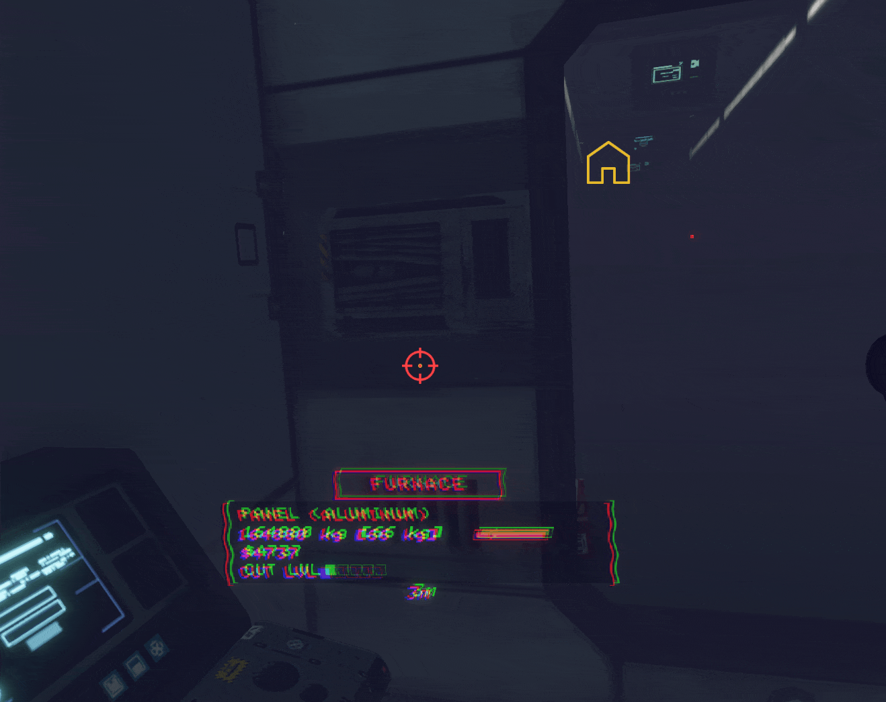
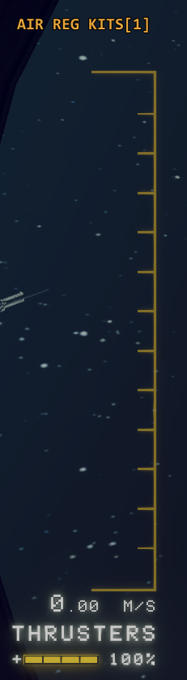
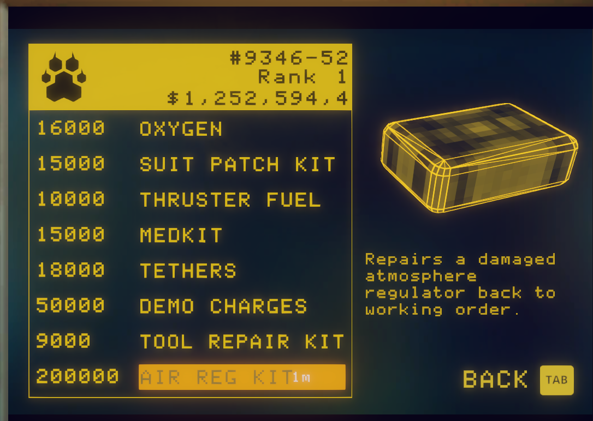

# Repairable Regulators

A [BepInEx](https://github.com/BepInEx/BepInEx) plugin for *Hardspace: Shipbreaker* that lets you repair a non-functional atmosphere regulator into a real, fully working one - button, animation, room pressurization, and the ship's manual toggle control all included, not just a cosmetic fix.



## Features

- **Repair a Damaged regulator.** Look at one and hold **F6** for a few seconds to bring it back to full working order - the same button press, animation, and air-pressure response a regulator that was never broken has.
- **Costs an Air Reg Kit**, purchasable from the ship's own vendor during a shift. A small on-screen counter tracks how many you're carrying.

  

- **An on-screen prompt**, styled to match the game's own interaction prompts, shows up whenever you're looking at something repairable - including a clear "need a kit" state if you're out.
- **Optional regulator status coloring** (green/blue/yellow/red, by pressurization/damage/destruction) - the plugin's original feature, off by default in a release build but a flip of a config switch away.

Bought from the ship's own vendor, alongside the real items, at the same size and style:



## Installing

Grab the built DLL (or build it yourself, below) and drop it in `BepInEx/plugins/RepairableRegulators/`. Requires [BepInEx](https://github.com/BepInEx/BepInEx) already installed for *Hardspace: Shipbreaker*.

## Building

```powershell
dotnet build -c Release
```

Builds against your installed copy of the game (referencing its own `BBI.Unity.Game.dll`, etc.) and automatically copies the result into `BepInEx/plugins/RepairableRegulators/`. If the game isn't at the default Steam path:

```powershell
dotnet build -c Release -p:GameDir="D:\Games\Hardspace Shipbreaker"
```

## Configuration

A config file is generated at `BepInEx/config/shipbreaker.repairableregulators.cfg` after the first run, covering repair key/range/duration, the Air Reg Kit's price, prompt visibility, regulator colors, and more. See the [technical reference](docs/TECHNICAL.md#configuration) for the full list.

## Known issues

A couple of rough edges are still open - a repaired regulator's own indicator light doesn't animate color yet, and the on-screen kit counter has one remaining visibility quirk. Neither affects whether repairing actually works. Full details in the [technical reference](docs/TECHNICAL.md#known-issues).

## Want to know how it actually works?

The [technical reference](docs/TECHNICAL.md) is the full deep-dive - how the repair mechanism really works under the hood (cloning a working regulator's internals, wiring it into a room, keeping it honest if it's ever cut loose), the game-engine quirks that had to be worked around along the way, diagnostics, and every known issue in detail.

See [docs/ROADMAP.md](docs/ROADMAP.md) for what's planned next.

## AI disclosure

This plugin's code and documentation were developed with AI assistance. Everything was tested live in-game along the way, but you should know AI was involved before you trust a community mod with your save.
